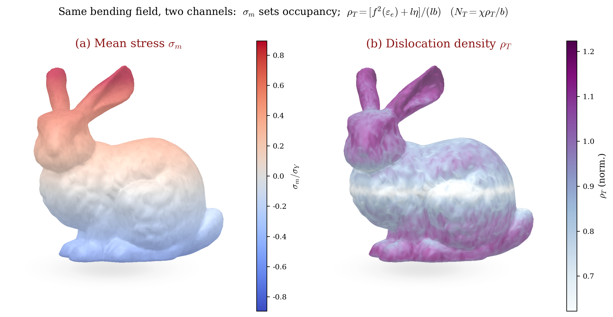

# Size-dependent hydrogen trapping in MSG plasticity

Companion code for the paper on **hydrogen transport and trapping** in
mechanism-based strain gradient (MSG) plasticity.

When metals deform at small length scales, strain gradients require
geometrically necessary dislocations (GNDs). Those dislocations supply trap
sites for hydrogen. The paper derives closed-form MSG–Oriani solutions for
torsion, bending, and void growth, then solves conventional MSG finite-element
problems for non-hydrostatic voids and a Mode-I slit with HELP softening.
This repository is the theory library and the figure factory behind those plots.

<p align="center">
  
</p>

<p align="center"><i>
Illustrative proxies of the two Fig.&nbsp;1 channels on one bending field
mapped to the Stanford bunny:<br/>
(a)&nbsp;signed mean stress σ<sub>m</sub>
(sets lattice / trap occupancy through Oriani);<br/>
(b)&nbsp;dislocation density
ρ<sub>T</sub>&nbsp;=&nbsp;[f<sup>2</sup>(ε<sub>e</sub>)&nbsp;+&nbsp;lη]/(lb)
from the same bend (outer fibers), which sets
N<sub>T</sub>&nbsp;=&nbsp;χρ<sub>T</sub>/b.
</i></p>

## Overview

MSG plasticity ties the flow stress to statistically stored and geometrically
necessary dislocations through an intrinsic material length $l$. Matching the
Taylor model to the uniaxial hardening law gives

$$
\sigma_e = \sigma_Y \sqrt{f^{2}(\varepsilon_e) + l\eta},\qquad
l = 3\alpha^{2}\left(\frac{\mu}{\sigma_Y}\right)^{2} b.
$$

Because $l$ is built from the same constants that enter the Taylor stress, the
hydrogen-free dislocation density and trap-site density collapse to

$$
\rho_{\mathrm{T}} = \frac{f^{2}(\varepsilon_e) + l\eta}{lb},\qquad
N_{\mathrm{T}} = \frac{\chi\rho_{\mathrm{T}}}{b}
= \frac{\chi}{lb^{2}}\bigl(f^{2}(\varepsilon_e) + l\eta\bigr).
$$

Under Oriani equilibrium, lattice and trapped occupancies respond to mean stress,

$$
\theta_L = \theta_L^{0}
\exp\left(\frac{\sigma_{\mathrm{m}} V_H}{RT}\right),\qquad
\frac{\theta_T}{1-\theta_T}
= K_T \frac{\theta_L}{1-\theta_L},\qquad
K_T = \exp\left(\frac{W_B}{RT}\right).
$$

The analytical chapters map this closure onto thin-wire torsion, ultra-thin
bending, and spherical void growth (size-dependent trap uptake). A finite-strain
cavitation analysis adds HELP softening

$$
\sigma_e^{\mathrm{HELP}} = (1 - \xi\theta_T)\sigma_e^{(0)}.
$$

The FEM panels reuse the same constitutive ideas on meshes.

## Quick start

```bash
git clone https://github.com/hanfengzhai/HydrogenMSG.git
cd HydrogenMSG
python3 -m pip install -e .
```

### Reproduce the manuscript figures

Panels cited in the current manuscript TeX:

```bash
python3 make_figures.py --manuscript
```

All companion panels (including SI extras):

```bash
python3 make_figures.py
```

Selected panels, mesh drawings, or a listing:

```bash
python3 -m hydrogenmsg.plot fig3b fig10a
python3 -m hydrogenmsg.plot --meshes
python3 -m hydrogenmsg.plot --list
```

Outputs are written to `output/` as PDF + PNG.

### Verify the FEM against closed forms

```bash
python3 -m hydrogenmsg.fem.void        # η operator, Lamé limit, plastic void fields
python3 -m hydrogenmsg.fem.canonical   # torsion / bending vs analytics
python3 -m hydrogenmsg.fem.slit        # elastic / HELP demos (slower)
```

### Call the theory library

```python
from hydrogenmsg import Params
from hydrogenmsg.analytics import torsion_Q, bending_fields, void_fields

p = Params()              # Huang-style MSG constants; bcc-iron hydrogen data
print(p.l * 1e6)          # intrinsic length [µm]
Q = torsion_Q(a=1e-6, Gamma=0.05, p=p)
```

## Constitutive notes

| Quantity | Choice |
|----------|--------|
| MSG length $l$ | $\mu_{\mathrm{ref}}/\sigma_Y = 200$ (Huang et al.) |
| FEM elasticity | $E/\sigma_Y = 500$, $\nu \approx 1/2$ (near-incompressible) |
| Trap density $N_{\mathrm{T}}$ | $N_{\mathrm{T}}=\chi\rho_{\mathrm{T}}/b$ with hydrogen-free $\rho_{\mathrm{T}}=[f^{2}+l\eta]/(lb)$ |
| HELP | Multiplies flow stress by $(1 - \xi\theta_T)$; Formulation C keeps $\rho_{\mathrm{T}}$ hydrogen-free |

## Requirements

`numpy`, `scipy`, `matplotlib` — see `requirements.txt` / `pyproject.toml`.
