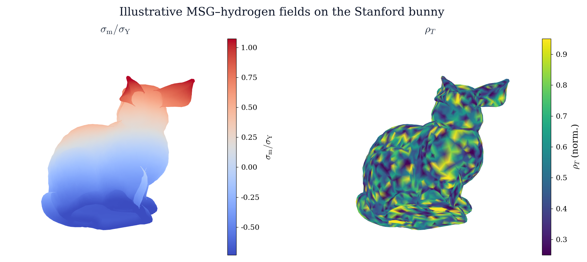

# Size-dependent hydrogen trapping in MSG plasticity

Companion code for the paper on **hydrogen transport and trapping** in
mechanism-based strain gradient (MSG) plasticity.

When metals deform at small length scales, strain gradients require
geometrically necessary dislocations (GNDs). Those dislocations supply trap
sites for hydrogen. The paper derives closed-form MSG–Oriani solutions for
torsion, bending, and void growth, then solves conventional MSG finite-element
problems for non-hydrostatic voids and a Mode-I slit with HELP softening.
This repository is the theory library and the figure factory behind those plots.

<p align="center">
  
</p>

<p align="center">
<em>Illustrative visualization proxies on the Stanford bunny:
$\sigma_{\mathrm{m}}/\sigma_{\mathrm{Y}}$ (left) and $\rho_{T}$ (right).</em>
</p>
## Overview

MSG plasticity ties the flow stress to statistically stored and geometrically
necessary dislocations through an intrinsic material length $l$. Matching the
Taylor model to the uniaxial hardening law gives

$$
\sigma_e = \sigma_Y\sqrt{f^{2}(\varepsilon_e)+l\,\eta},
\qquad
l = 3\alpha^{2}\Bigl(\frac{\mu}{\sigma_Y}\Bigr)^{2}b.
$$

Because $l$ is built from the same constants that enter the Taylor stress, the
hydrogen-free dislocation density collapses to

$$
\rho_T = \frac{f^{2}(\varepsilon_e)+l\,\eta}{l\,b},
\qquad
N_T = \frac{\chi\rho_T}{b}.
$$

Under Oriani equilibrium, lattice and trapped occupancies respond to mean stress,

$$
\theta_L = \theta_L^{0}\exp\!\Bigl(\frac{\sigma_m V_H}{RT}\Bigr),
\qquad
\frac{\theta_T}{1-\theta_T}=K_T\frac{\theta_L}{1-\theta_L},
\qquad
K_T=\exp\!\Bigl(\frac{W_B}{RT}\Bigr).
$$

The analytical chapters map this closure onto thin-wire torsion, ultra-thin
bending, and spherical void growth (size-dependent trap uptake). A finite-strain
cavitation analysis adds HELP softening
$\sigma_e^{\mathrm{HELP}}=(1-\xi\theta_T)\sigma_e^{(0)}$. The FEM panels reuse
the same constitutive ideas on meshes.

## Repository layout

```text
hydrogenmsg/
  analytics.py     # closed-form MSG–Oriani model
  fem/             # void, slit, and canonical FEM solvers
  plot/            # manuscript figure generators + CLI
docs/              # README figures
output/            # generated PDF/PNG panels (from the CLI)
make_figures.py
```

## Quick start

```bash
git clone https://github.com/hanfengzhai/HydrogenMSG.git
cd HydrogenMSG
python3 -m pip install -e .
```

### Reproduce the manuscript figures

Panels cited in the current manuscript TeX:

```bash
python3 make_figures.py --manuscript
```

All companion panels (including SI extras):

```bash
python3 make_figures.py
```

Selected panels, mesh drawings, or a listing:

```bash
python3 -m hydrogenmsg.plot fig3b fig10a
python3 -m hydrogenmsg.plot --meshes
python3 -m hydrogenmsg.plot --list
```

Outputs are written to `output/` as PDF + PNG.

### Verify the FEM against closed forms

```bash
python3 -m hydrogenmsg.fem.void        # η operator, Lamé limit, plastic void fields
python3 -m hydrogenmsg.fem.canonical   # torsion / bending vs analytics
python3 -m hydrogenmsg.fem.slit        # elastic / HELP demos (slower)
```

### Call the theory library

```python
from hydrogenmsg import Params
from hydrogenmsg.analytics import torsion_Q, bending_fields, void_fields

p = Params()              # Huang-style MSG constants; bcc-iron hydrogen data
print(p.l * 1e6)          # intrinsic length [µm]
Q = torsion_Q(a=1e-6, Gamma=0.05, p=p)
```

## Constitutive notes

| Quantity | Choice |
|----------|--------|
| MSG length $l$ | $\mu_{\mathrm{ref}}/\sigma_Y=200$ (Huang et al.) |
| FEM elasticity | $E/\sigma_Y=500$, $\nu\approx\tfrac12$ (near-incompressible) |
| Trap density $N_T$ | Hydrogen-free Taylor density $f^{2}+l\eta$ |
| HELP | Multiplies flow stress by $(1-\xi\theta_T)$ |

## Requirements

`numpy`, `scipy`, `matplotlib` — see `requirements.txt` / `pyproject.toml`.
