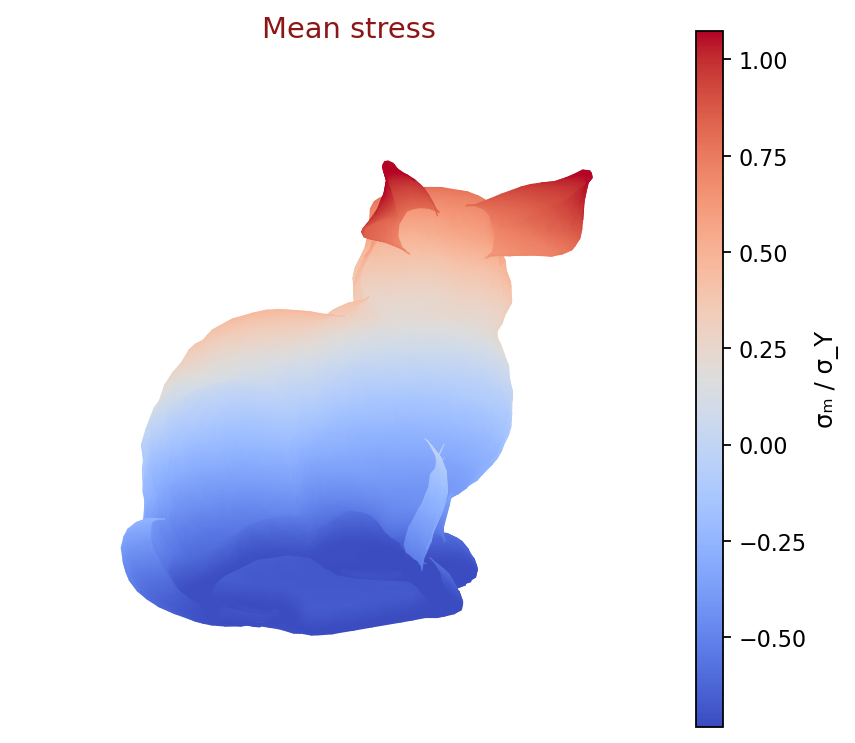
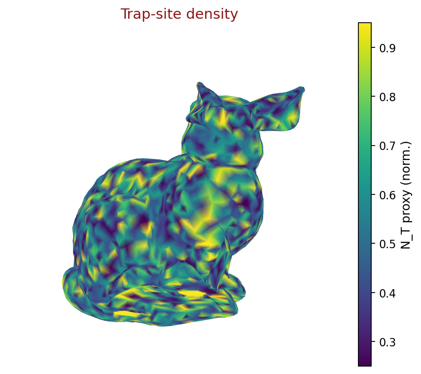

# Size-dependent hydrogen trapping in MSG plasticity

Companion code for the paper on hydrogen transport and trapping in
mechanism-based strain gradient (MSG) plasticity.

When a metal deforms at small length scales, strain gradients force
geometrically necessary dislocations (GNDs) to appear. Those dislocations
add trap sites for hydrogen. The paper works out closed-form MSG–Oriani
solutions for torsion, bending, and void growth, then uses conventional MSG
finite elements for non-hydrostatic voids and a Mode-I slit with HELP
softening. This repository is the theory library and the figure factory used
to produce the manuscript plots.

<p align="center">
  
  
</p>

<p align="center"><em>
Illustrative MSG–hydrogen fields on the Stanford bunny (visualization proxies).<br/>
Left: mean stress σ<sub>m</sub>/σ<sub>Y</sub>.
Right: trap-site density N<sub>T</sub> (dislocation-density proxy).
</em></p>

## What the paper does

1. **Taylor / trap closure.** MSG flow stress and the hydrogen-free dislocation
   density share the same intrinsic length $l$, so
   $\rho_T = [f^2(\varepsilon_e)+l\eta]/(l b)$ and $N_T=\chi\rho_T/b$.
2. **Analytical size effects.** Wire torsion, ultra-thin bending, and spherical
   void growth: thinner specimens store more GND traps and more trapped hydrogen.
3. **Cavitation with HELP.** Finite-strain cavitation couples occupancy back into
   the flow stress through a softening factor $(1-\xi\theta_T)$.
4. **FEM panels.** Axisymmetric voids and a Mode-I slit check the same constitutive
   ideas on meshes (hydrogen is an Oriani post-process on the mechanical fields).

## Repository layout

```
hydrogenmsg/
  analytics.py   # closed-form MSG–Oriani model
  fem/           # void, slit, and canonical FEM solvers
  plot/          # manuscript figure generators + CLI
docs/            # README images
output/          # generated PDF/PNG panels (created when you run the CLI)
make_figures.py
```

## Quick start

```bash
git clone https://github.com/hanfengzhai/HydrogenMSG.git
cd HydrogenMSG
python3 -m pip install -e .
```

### Reproduce the manuscript figures

Everything cited in the TeX (fastest useful default):

```bash
python3 make_figures.py --manuscript
```

All companion panels (includes SI extras):

```bash
python3 make_figures.py
```

One panel, or the FEM mesh drawings:

```bash
python3 -m hydrogenmsg.plot fig3b
python3 -m hydrogenmsg.plot --list
python3 -m hydrogenmsg.plot --meshes
```

Panels land in `output/` as PDF + PNG.

### Check the solvers against closed forms

```bash
python3 -m hydrogenmsg.fem.void        # strain-gradient operator, Lamé limit, plastic void fields
python3 -m hydrogenmsg.fem.canonical   # torsion / bending vs analytics
python3 -m hydrogenmsg.fem.slit        # elastic / HELP demos (slower)
```

### Use the theory library in Python

```python
from hydrogenmsg import Params
from hydrogenmsg.analytics import torsion_Q, bending_fields, void_fields

p = Params()                 # Huang-style MSG constants, bcc-iron hydrogen data
print(p.l * 1e6)             # intrinsic length in µm
Q = torsion_Q(a=1e-6, Gamma=0.05, p=p)
```

## Notes on constitutive choices

- MSG length $l$ uses the constitutive reference $\mu_{\mathrm{ref}}/\sigma_Y=200$.
- FEM elasticity uses near-incompressible $\nu\approx 1/2$ with the same
  $E/\sigma_Y$, so $\mu_{\mathrm{FEM}}$ differs from $\mu_{\mathrm{ref}}$ by design.
- Trap density always uses the hydrogen-free Taylor expression above. HELP
  multiplies the flow stress by $(1-\xi\theta_T)$.

## Requirements

`numpy`, `scipy`, `matplotlib` (see `requirements.txt` / `pyproject.toml`).
